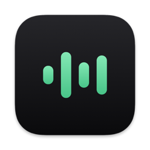

  

<h1 align="center">PrivacyFlow</h1>

  <strong>Private dictation for the Mac.</strong> 
  Hold a key, speak, let go. Your words appear where you are typing, and they never leave your Mac.

  
  
  
  
  

  

## Private by design

Many dictation tools send your voice to a server.
PrivacyFlow never does.

- **Everything runs on your Mac.** Speech recognition and text cleanup happen on its own GPU.
- **No account, no cloud, no telemetry.** There is nothing to sign up for and nothing phones home.
- **The network is used only to download the speech models**, once, on first launch. Every file is checked against a fixed checksum.
- **Recordings are deleted immediately.** Audio exists only while it is being transcribed.
- **Nothing is kept.** Recent dictations are shown in the console while PrivacyFlow runs and are gone when you quit.
- **The microphone is off between dictations.** It listens only while you hold the key.
- **Open source**, so you do not have to take any of this on trust.

## What it does

PrivacyFlow turns speech into finished text, not just a transcript.
A small model reads each dictation and decides whether it can go in exactly as spoken, or needs tidying first.
When it does, S1-mini by Superwhisper rewrites it: punctuation fixed, spoken corrections applied ("Friday, actually no, Thursday" becomes "Thursday"), and a spoken list turned into a list.
Most dictations go in untouched.

It works in almost any app you can type in.

## How to install

You need a Mac with Apple Silicon (M1 or later) running macOS 14 Sonoma or later, and about 3 GB of free disk space.

1. Download `PrivacyFlow-<version>.dmg` from the [latest release](https://github.com/Fz77z/PrivacyFlow/releases/latest).
2. Open it and drag **PrivacyFlow** into **Applications**.
3. Open PrivacyFlow from Applications.

PrivacyFlow is not yet signed with an Apple Developer ID, so macOS blocks the first launch and says it cannot verify the app.
To allow it, open **System Settings → Privacy & Security**, scroll down to the message about PrivacyFlow, and click **Open Anyway**.
You only need to do this once for each version.

### First launch

A setup window walks you through the rest:

1. **Download the speech models**, about 2.5 GB in all.
2. **Grant three permissions** in System Settings → Privacy & Security.
   The setup window has buttons that open each page.

| Permission | Why PrivacyFlow needs it |
| --- | --- |
| Microphone | To hear you while you hold the dictation key |
| Accessibility | To paste the text into the app you are using |
| Input Monitoring | To notice the dictation key while another app is in front |

If PrivacyFlow is missing from the Input Monitoring list, add it with the **+** button.
Quit and reopen PrivacyFlow after granting Accessibility and Input Monitoring; macOS applies them at launch.
macOS may offer to do this for you, and that is safe even while the models download: the download picks up where it left off.

## How to use

**Hold Right Option, speak, and let go.**
The capsule shows that PrivacyFlow is listening, then working, and the text appears at your cursor.

- **Keep talking.** You can start the next dictation while the last one is still being processed. They are inserted in the order you spoke.
- **Nothing gets lost.** The text is also left on the clipboard. If you switched apps before it was ready, it is not pasted into the wrong one; paste it yourself with ⌘V.
- **Open the console** from the menu bar icon, or by right-clicking the capsule, to see recent dictations, change settings, check status, or quit.

In Settings you can:

- **Choose the dictation key.** Right Option is the default. Any modifier works on its own (Left Control, Right Command, Fn and so on), as do function keys and combinations such as ⌃⌥ plus a letter. PrivacyFlow refuses keys you type with, and warns about keys macOS uses itself.
- **Pick a microphone.** PrivacyFlow uses the system input unless you choose one.
- **Turn the sound cues off.**
- **Use minimal mode**, which folds the capsule into a small button until you dictate.

PrivacyFlow understands English.

## Troubleshooting

**The dictation key does nothing while another app is in front.**
Input Monitoring is missing. Grant it, then quit and reopen PrivacyFlow.

**The text is transcribed but never appears.**
Accessibility is missing. The text is on the clipboard in the meantime.

**A permission is switched on but still does not work, usually after an update.**
Because PrivacyFlow is not yet signed with a Developer ID, macOS treats each new version as a different app.
In System Settings → Privacy & Security, select PrivacyFlow in the list, remove it with the **−** button, and add `/Applications/PrivacyFlow.app` again with **+**.
Switching it off and on again does not help.

**The dictation key stops working in a password field or some terminals.**
That app has turned on secure keyboard entry, which hides the keyboard from every other app. The Status tab says when this is happening.

## Uninstall

Quit PrivacyFlow, then delete:

- `/Applications/PrivacyFlow.app`
- `~/Library/Application Support/PrivacyFlow` (the models and your settings)
- `~/Library/Caches/io.github.fz77z.privacyflow`

You can also remove PrivacyFlow from the permission lists in System Settings → Privacy & Security.

## Under the hood

The app is written in Swift.
The models run in a Python process bundled inside the app, on the Mac's GPU through [MLX](https://github.com/ml-explore/mlx), and stay locked in memory so the first dictation after a long break is as fast as any other.
That uses about 2.5 GB of memory while PrivacyFlow runs.

| Step | Model |
| --- | --- |
| Is this speech? | [Silero VAD](https://github.com/snakers4/silero-vad) |
| What was said? | [Whisper large-v3-turbo](https://huggingface.co/openai/whisper-large-v3-turbo), 8-bit |
| Does it need a rewrite? | Kev router, built on [Qwen2.5-0.5B](https://huggingface.co/Qwen/Qwen2.5-0.5B) |
| The rewrite | [S1-mini](https://huggingface.co/superwhisper/s1-mini) by Superwhisper, 8-bit |

See [docs/architecture.md](docs/architecture.md) for how it fits together, and [docs/development.md](docs/development.md) to build it yourself.

## License

PrivacyFlow is released under the [MIT License](LICENSE).
The models and bundled libraries keep their own licenses, listed in [THIRD_PARTY_NOTICES.md](THIRD_PARTY_NOTICES.md).

S1-mini is made by [Superwhisper](https://superwhisper.com).
Speech recognition is OpenAI's Whisper, run with Apple's MLX.
